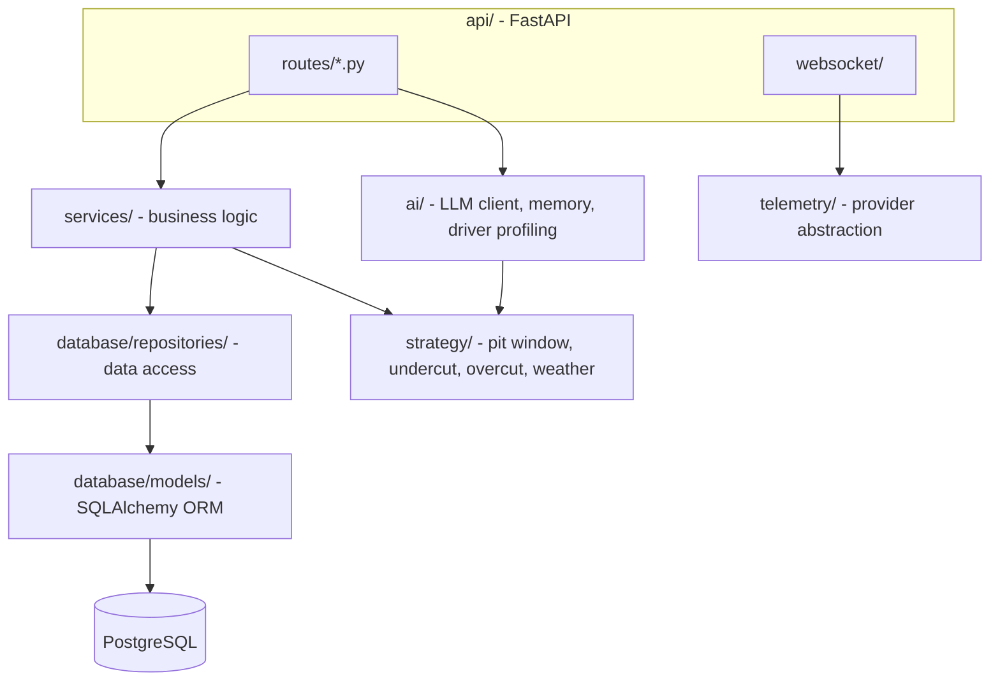

# Architecture

## Layering (backend)

Each layer only talks to the one below it. Routes never touch the
database directly; they call a service, which calls a repository. This
is what makes the strategy engine and telemetry abstraction testable in
isolation (see `backend/tests/test_strategy_engine.py` and
`test_telemetry_replay.py` - neither touches a database at all).

## Telemetry abstraction

`telemetry.provider.TelemetryProvider` is the single interface every
data source implements:

- **`udp_listener.UDPProvider`** - live game data. The asyncio socket
  transport and packet dispatch are real; per-game-year byte-layout
  decoding (`telemetry/parsers/f1_*.py`) is deliberately left as typed,
  registered stubs rather than a guess - see `packet_router.py`'s
  docstring for why.
- **`replay.ReplayProvider`** - replays a recorded session from JSON
  Lines. Fully implemented, since it's just reading back RaceMind AI's
  own normalized format.
- **`recorder.TelemetryRecorder`** - the inverse of replay: subscribes
  to any provider and writes what it sees to the same JSONL format.
- **`plugin_provider.PluginProvider`** - placeholder for Assetto Corsa,
  ACC, iRacing, Le Mans Ultimate, rFactor 2.

Every consumer (the WebSocket broadcaster, the strategy engine, the
recorder) depends only on `TelemetryProvider`'s `subscribe()`/`stream()`
interface, never on which transport or game produced the data.

## Strategy engine

Composed from independently-testable sub-modules rather than one large
class:

| Module | Answers |
|---|---|
| `tyre.py` | When does this compound hit its wear cliff? |
| `fuel.py` | How many laps of fuel are left? |
| `pit_window.py` | Combining both - what's the pit window? |
| `undercut.py` | Can we jump the car ahead by pitting first? |
| `overcut.py` | Can we stay out and jump the car behind once they pit? |
| `traffic.py` | Would our pit exit land in a pack? |
| `weather.py` | Does the compound need to change? |
| `race_engineer.py` | Composes all of the above into one recommendation |

## Why Postgres schema changes go through Alembic, not `schema.sql`

`backend/alembic/versions/` is the real source of truth, generated from
the SQLAlchemy models in `backend/database/models/`. `database/schema.sql`
at the repo root is a generated read-only reference dump for anyone who
wants to see the DDL without reading Python - see `database/README.md`.

## Status

Backend is implemented and verified: full test suite green against both
SQLite and Postgres, `mypy`/`ruff` clean, a real Alembic migration
applied to a real Postgres instance. Website, desktop app, and the
shared `packages/` are not yet built.
